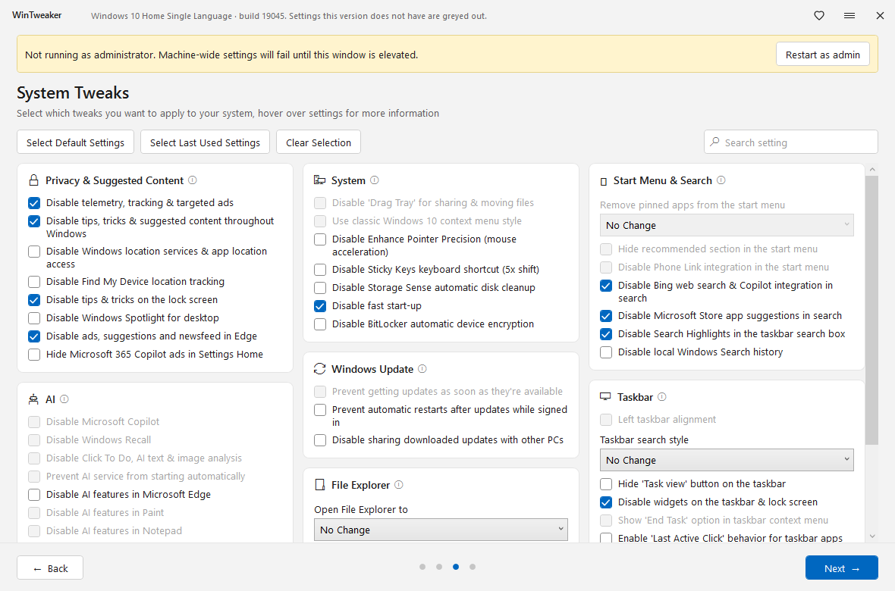

# WinTweaker

Твикер для Windows 7, 10 и 11. Сначала выбираешь, что поменять. Запись на диск начинается только на Apply.



Жёлтая полоса на снимке видна, только если окно открыто без прав администратора. Файл из релиза запрашивает их сам.

## Что внутри

Четыре шага.

1. **Welcome.** Точка восстановления и перезапуск Explorer.
2. **Apps.** Снос предустановленных Store-приложений. На Windows 7 страница пустая.
3. **System Tweaks.** Три колонки карточек, поиск, пресет, последний выбор, очистка. Наведи курсор на пункт, чтобы увидеть, что именно он пишет.
4. **Review.** Список выбранного, Apply и лог.

Пункты, которых нет на текущей системе, серые. На Windows 10 это Copilot, Recall, Drag Tray и остальное, что появилось только в 11.

## Запуск

Нужны права администратора и .NET Framework 4.8. На Windows 10 и 11 он уже стоит. На Windows 7 его надо поставить отдельно.

Скачай [WinTweaker-0.1.0.zip](https://github.com/WinSCP-Project/WinTweaker/releases/latest), распакуй и запусти `WinTweaker.exe`. Рядом должен лежать `WinTweaker.exe.config`.

## Что делает Apply

- Пишет параметры реестра: приватность, оболочка, обновления, проводник, меню Пуск, панель задач.
- Меняет тип запуска служб телеметрии и AI, если такая служба есть в системе.
- Снимает отмеченные Store-приложения.
- Может заменить раскладку закреплённых ярлыков Пуска пустым шаблоном.
- Перед записью создаёт точку восстановления, если на системном диске включена защита системы.
- По галке на первой странице перезапускает Explorer.

Снимок для отката лежит в `%LocalAppData%\WinTweaker\backups`. Откат: меню окна, **Undo last apply**. Удалённые приложения откат не возвращает.

## Сборка

```
dotnet build src/WinTweaker/WinTweaker.csproj -c Release
```

Готовый файл: `src/WinTweaker/bin/Release/WinTweaker.exe`.

## Пустой шаблон меню Пуск

`src/WinTweaker/Assets/start2.bin` — пустая раскладка Windows 11 без закреплённых ярлыков. Файл взят из [Raphire/Win11Debloat](https://github.com/Raphire/Win11Debloat) (MIT). Текст лицензии лежит рядом, в `src/WinTweaker/Assets/start2-NOTICE.txt`.
